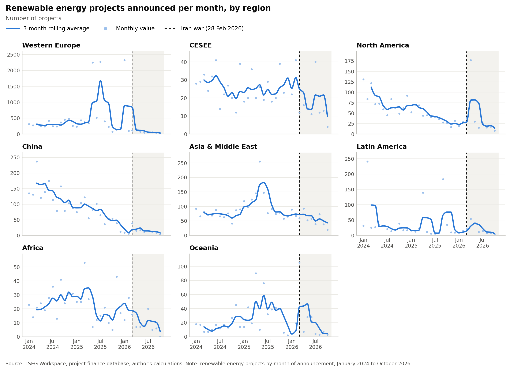

# Renewable_Energy_Project# Renewable Energy Project Finance and the 2026 Iran War

How did announcements of renewable energy projects change after the start of the Iran war (28 February 2026)?
This project tracks renewable project finance deals worldwide from January 2024 to October 2026, by region,
country and technology, using LSEG's project finance database.

## Main outputs

- **Interactive dashboard:** `output/pf/pf_dashboard.html` (download and open in a browser; works offline)
- **Figures:** `output/pf/figures/`



## Repository structure

```
notebook/
  01_pf_download_and_panel.ipynb   download from LSEG, tidy, assign technology, build monthly panel
  02_clean_and_explore.ipynb       data quality checks, descriptive statistics, figures, dashboard
output/pf/
  figures/                         static charts (PNG)
  pf_dashboard.html                interactive dashboard
data/                              not included (see Data)
```

## Data

The data come from LSEG Workspace (project finance database) and cannot be shared because of licensing.
With LSEG access, running notebook 01 downloads them into `data/raw/pf/` and builds `data/clean/`.

## Method in brief

- One row per project, counted in its month of announcement
- Technology assigned from project names (solar, wind, hydro, storage, etc.); hydrogen excluded
- Reported costs above USD 50 bn treated as missing (likely local currency); costs cover disclosed projects only
- Standardised site-list records, added by LSEG in batches, are flagged and excluded where noted
- Pre-war period up to February 2026, post-war from March 2026

## Caveats

Announcements are not committed investment. Recent months are likely to be revised upwards as LSEG adds projects.

## Requirements

Python 3.11+, pandas, numpy, pyarrow, matplotlib, scipy, plotly, and `lseg-data` for notebook 01.

## Author

Shirin Dehghannezhad
